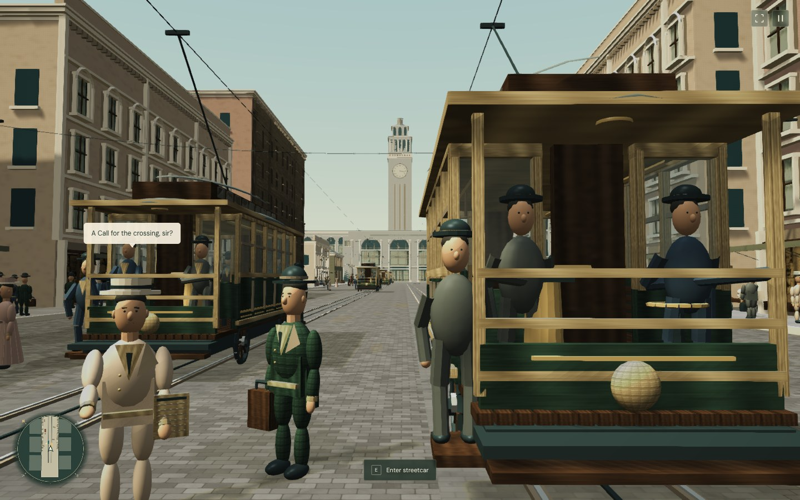
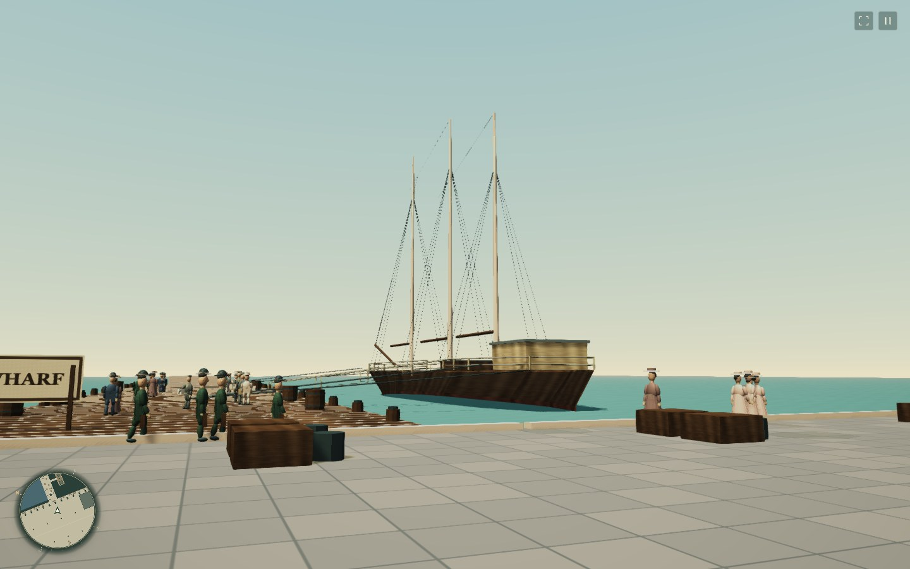
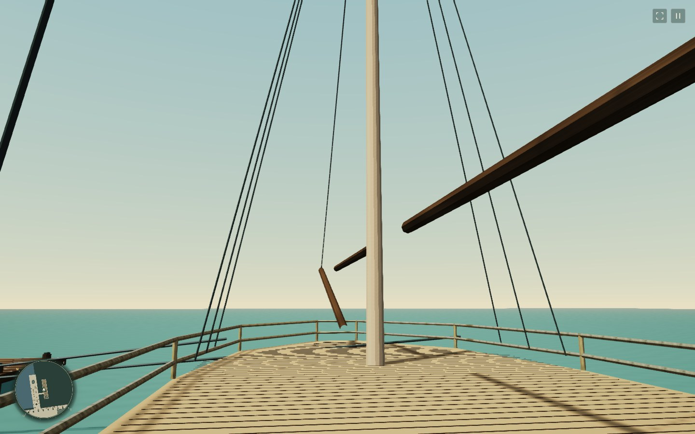

# GTA-SF

**Explore San Francisco in 1906, on foot, by streetcar, and aboard a lumber schooner.**

[Play in your browser](https://ktwu01.github.io/GTA-SF1906/) · [Download v0.3.0](https://github.com/ktwu01/GTA-SF1906/releases/tag/v0.3.0) · [Report a bug or suggest an idea](https://github.com/ktwu01/GTA-SF1906/issues) · [Gameplay guide](docs/historical-sf/mvp.md)



GTA-SF is a browser game built around lower Market Street, the Ferry Building, and a working waterfront. Step from the original Miles Brothers film into a playable interpretation of the street. Meet pedestrians, ride a streetcar, carry freight to the wharf, or take the schooner out into the bay.

The current release is a compact historical district. Buildings and street details draw on period photographs and archival records. Colors, surrounding dimensions, traffic, dialogue, and activities are interpretations.

## Around the waterfront

| Working waterfront | Aboard the schooner |
| --- | --- |
|  |  |

- Walk from Market Street through the Ferry apron to the warehouses, quay, timber wharf, and ship.
- Board a streetcar, drive along the rails, or ride automatically.
- Hear nearby conversations and ask for directions. Replies can select a map destination.
- Collect and deliver three parcels between the freight office and timber wharf.
- Set sail from the schooner helm. Steer in open water, then return through automatic docking.
- Compare the opening view with the archival film and browse the photograph archive.

## Play the release

Open [GTA-SF](https://ktwu01.github.io/GTA-SF1906/) to play without installation.
Share the same link with friends.
A desktop browser with WebGL2 support is recommended.

Download `GTA-SF-v0.3.0-historical.zip` from the [release page](https://github.com/ktwu01/GTA-SF1906/releases/tag/v0.3.0).
Extract the ZIP into a folder.
Run this command inside the extracted folder:

```sh
python3 -m http.server 8080
```

Open `http://localhost:8080` in a browser with WebGL2 support. A desktop browser is recommended. Touch controls are also available.

The download contains the standalone historical game and its assets. It does not require the original Shenzhen city assets or an AI API key.

## Controls

| Input | Action |
| --- | --- |
| W/A/S/D | Walk; control speed and steering at sea |
| Mouse click or drag | Look around |
| Shift / Space | Run / jump on foot |
| E or nearby prompt | Enter or leave a streetcar; pick up or deliver cargo; set sail or return |
| W / S or Space in a streetcar | Accelerate / brake |
| R | Reverse a stopped streetcar; return to the wharf after sailing departure |
| B | Ring the streetcar bell |
| 1 / 2 | Choose a conversation reply |
| Esc | Release the mouse and pause |
| V / H | Toggle fullscreen / interface |

Choose a destination from **Pause → Places** to follow a walking route. On touch screens, use the movement stick, drag to look, and tap the nearby interaction prompt.

## Run from source

Use Node.js 24 and npm.

```sh
git clone https://github.com/ktwu01/GTA-SF1906.git
cd GTA-SF1906
npm ci
npm run dev:historical
```

Open `http://127.0.0.1:4176/`.

Build and preview the standalone game:

```sh
npm run build:historical
npm run preview:historical
```

Open `http://127.0.0.1:4177/`. The build output is `dist-historical/`.

On a MacBook Air, keep at most two game instances open across browser tabs and automation sessions. Reuse a tab for screenshots and checks.

## Contribute

Start with a specific place, interaction, or bug. Include a screenshot and reproduction steps when reporting a visual or gameplay issue.

| Area | Starting point |
| --- | --- |
| Browser interface and controls | [main.ts](src/historical-sf/main.ts) |
| Scene and game state | [scene.ts](src/historical-sf/scene.ts) |
| Street buildings | [architecture.ts](src/historical-sf/architecture.ts) |
| Waterfront and ship | [harbor.ts](src/historical-sf/harbor.ts), [harbor-layout.ts](src/historical-sf/harbor-layout.ts) |
| Cargo and sailing | [harbor-work.ts](src/historical-sf/harbor-work.ts) |
| Walking routes and dialogue | [navigation.ts](src/historical-sf/navigation.ts), [dialogue.ts](src/historical-sf/dialogue.ts) |
| Historical sources | [sources.json](data/historical-sf/sources.json), [building records](data/historical-sf/buildings.json) |

Run the historical checks before submitting a change:

```sh
npm run test:historical
npm run build:historical
```

The v0.3.0 checks passed 41 historical tests and the production build. Chrome checks completed cargo delivery, sailing, docking, and disembarking. The full repository suite also includes the inherited Shenzhen and Unreal projects; 18 asset-dependent tests fail in the current checkout, matching the main-branch baseline.

Read [AGENTS.md](AGENTS.md) for project instructions and [the gameplay guide](docs/historical-sf/mvp.md) for reconstruction details. Record sources for historical claims. Keep measured dimensions separate from estimates. Research-only reference copies belong in `local-only/`.

## Built on GTA_SZ

GTA-SF builds on [GTA_SZ / ShenChengJi (深城纪)](https://github.com/linranff/GTA_SZ), created by linranff and its contributors. The inherited Shenzhen city, asset tools, and experimental Unreal project remain in this repository. The historical San Francisco experience has its own entry point and build commands.

The browser game uses Babylon.js, TypeScript, and Vite. Historical geometry is generated in the scene; archival images supply reference material and selected textures. [The reference workflow](docs/historical-sf/reference-build.md) records how those inputs are prepared.

## Credits and licensing

Code is covered by the [MIT license](LICENSE). Retain upstream copyright notices when redistributing it.

Historical images and film retain the rights statements in [the source ledger](data/historical-sf/sources.json) and [the bundled reference manifest](public/historical-sf/references/manifest.json). The original film is held by the [Library of Congress](https://www.loc.gov/item/00694408/). Dialogue is fictional; the [bundled voices](public/historical-sf/voices/README.md) were synthesized locally. Bundled fonts use the [SIL Open Font License](public/historical-sf/fonts/DM-Sans-OFL.txt).

The code license does not apply automatically to every asset. The inherited Shenzhen data and models have separate notices in [data attribution](data/ATTRIBUTION.md), [asset licenses](public/licenses), and [character provenance](public/characters/manifest.json). Keep their terms when using or redistributing those assets.
